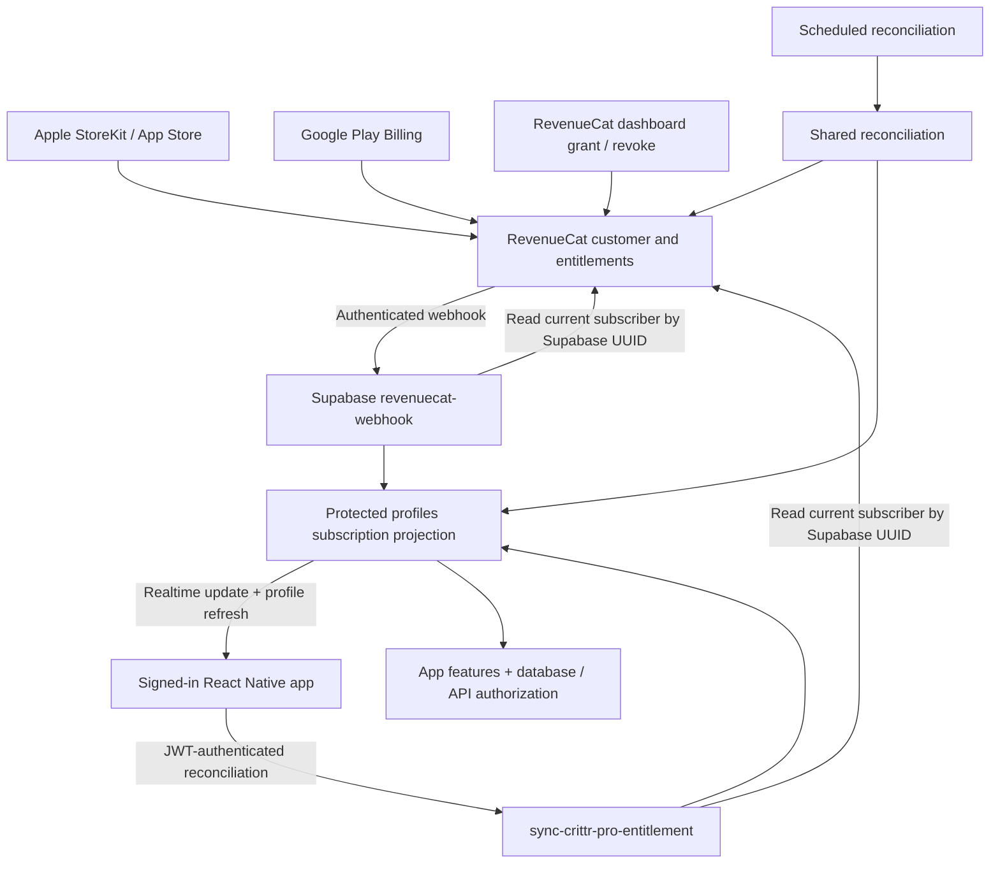

# Subscription architecture and RevenueCat grants

Reviewed and deployed October 26, 2026. Scope is subscription identity, verification, synchronization, billing presentation, and regression coverage. The Supabase billing deployment below is complete. RevenueCat/Apple/Google dashboard settings and the updated app's device/release validation remain separate from this backend deployment.

## Production deployment completed

Project: `crittr` (`slnmfelxigtlrdyogsjn`). Deployed through the authenticated local Supabase CLI, using explicit function names and a staged directory containing only billing source.

| Component | Deployed state |
| --- | --- |
| `sync-crittr-pro-entitlement` | Active, version 28 |
| `revenuecat-webhook` | Active, version 8 |
| `reconcile-crittr-pro-entitlements` | Active, version 1 |
| Billing database | Applied `docs/sql/install-subscription-sync.sql`: verified helper, protected billing fields, service-only reconciliation RPCs/tables, webhook ledger, and profile Realtime publication |
| Recovery job | `crittr-pro-reconciliation`, active every minute through `pg_cron` and `pg_net`; its first scheduled HTTP request returned 200 with zero failures |
| Worker authorization | Dedicated `ENTITLEMENT_RECONCILE_AUTH`, stored in Edge Function secrets and Supabase Vault; the existing RevenueCat secrets were preserved |

All **28 existing accounts** were reconciled against RevenueCat, in batches of 20 and 8, with **zero failures**. There are now **7 verified Pro accounts: 5 production store entitlements and 2 promotional lifetime grants**. Both lifetime grants pass the same authorization helper as paid access. No active account lacks its verified environment, and no promotional grant is marked auto-renewing. No new RevenueCat entitlement was granted, no store subscription was cancelled, and no verification metadata was fabricated from legacy boolean flags.

Live authentication checks returned 401 for unauthenticated requests to all three functions. The billing RPCs and private tables deny `anon` and `authenticated` access and allow `service_role`. Profile Realtime is enabled under the existing SELECT policies.

The 20 pets, co-carer count, and pet/co-care policy fingerprint were unchanged. Unrelated function code hashes and code-update timestamps were unchanged. Supabase's project-wide secret refresh incremented their version counters without changing their source. The broader pet/co-care migrations and other pending feature migrations were **not** applied.

## Initial audit, before deployment

The linked project had six profiles marked active, all six without a subscription environment, and zero profiles passing `account_has_verified_pro`. These were legacy flags, not independently verified RevenueCat purchases.

The previous sync handler (version 26) and webhook (version 6), last updated August 15, 2026 UTC, never wrote `subscription_environment` and skipped verification timestamp updates when purchase metadata was unchanged. The current app requires both, creating a concrete backend/app compatibility failure.

The helper/profile columns existed, but reconciliation RPCs, the webhook ledger, profile Realtime, the worker, and its authorization secret were missing. Those gaps are now resolved by the scoped deployment. The project has no CLI migration-history table; schema prerequisites were inspected directly and the scoped installer was applied transactionally, rather than using a blind `db push`.

## Authority and data flow



RevenueCat is the purchase/entitlement authority. Supabase stores a verified projection used consistently by app labels, feature gates, database policies, and server functions. Native `CustomerInfo` supplies purchase metadata and triggers reconciliation; a device response never overrides server authorization.

This follows RevenueCat's recommendation to fetch the current subscriber after webhooks instead of reconstructing access from individual event types. Duplicate events are recorded, failures remain retryable, and per-account leases/fencing prevent concurrent workers from overwriting newer results. Transfers reconcile both source and destination accounts. [RevenueCat webhooks](https://www.revenuecat.com/docs/integrations/webhooks)

The Supabase user UUID is the RevenueCat App User ID on both platforms. Native login, purchase, restore, and logout share one identity queue, and work from a previous auth generation is rejected. The server derives identity from the verified Supabase JWT and does not trust client-provided aliases or legacy profile mappings. Both public SDK keys and the server API key must belong to the same RevenueCat project. [Identifying customers](https://www.revenuecat.com/docs/customers/identifying-customers)

## Why dashboard access could appear missing

The code audit found these concrete gaps; identifying which affected a particular live account still requires its dashboard and delivery history:

| Gap | Correction |
| --- | --- |
| Access checks ignored `Crittr Pro`, despite existing legacy identifier support in billing metadata. | The exact canonical `crittr_pro` and legacy `Crittr Pro` identifiers are honored consistently. Unrelated entitlements grant nothing. When both are active, the longest access wins, with lifetime preferred. |
| An open app depended on a native callback or a five-minute poll to notice external changes. | Subscribe to the signed-in user's verified profile. Refresh on reconnect, launch, foreground, native updates, and periodic recovery. Retry transient sync failures and retain updates arriving during throttling. |
| Subscription details only used native metadata, which could be absent/stale even after server verification. | Identify the explicit account, invalidate the native cache, bound the lookup, and use the verified profile when native details are unavailable or describe an older product. Refresh the billing query when profile access changes. |
| Promotional transaction records could be marked auto-renewing. Temporary grants appeared monthly/canceled. | Grants never auto-renew, do not query store prices, and display complimentary or lifetime access without cancellation/resubscribe controls. |
| A stalled native lookup delayed independent server reconciliation. Shared failed requests could reject inconsistently. | Native identification cannot block the server request, and all coalesced callers receive the same failure result. |
| Production SDK configuration could retain a completed promise after initialization failed. | Clear the configuration flight after settlement so later attempts can recover. |
| A restore screen could report success without confirming server access. | Wait for the verified projection before reporting restored Pro. Subscription-screen focus reconciles before redirecting to a paywall. |

Malformed provider responses preserve the previous verification instead of silently downgrading. A valid empty entitlement response or confirmed expiry revokes access. Cancellation retains access through the paid term; valid grace periods extend access through their deadline. One-time store purchases retain their store/sandbox metadata. Google Play matching accounts for retained base plans rather than selecting an old refunded plan.

## Grant lifetime Pro to a user

1. Find the user's UUID in Supabase Authentication. In the correct RevenueCat project, open the customer whose App User ID or alias matches that UUID. Granting access to an email address or an unrelated anonymous customer will not grant this app account access.
2. Grant the entitlement with identifier **`crittr_pro`**, choosing **Lifetime**. Existing grants to **`Crittr Pro`** are also supported for compatibility; use the canonical identifier going forward.
3. Confirm the customer has an active entitlement in RevenueCat. An explicit null expiry represents non-expiring access. The billing screen also recognizes active `rc_promo_*_lifetime` records for lifetime presentation when they carry a finite deadline; authorization still enforces that actual deadline. A product name alone never grants access.
4. Verify delivery of the production **`NON_RENEWING_PURCHASE`** event to `revenuecat-webhook` with HTTP 200. Grant revocation generates **`CANCELLATION`**. The handler reads the latest subscriber, so delayed older events cannot reinstate revoked access.
5. The corresponding Supabase projection should become active with `subscription_environment = 'promotional'`, `subscription_will_renew = false`, and the RevenueCat grant's expiry. With the new publication enabled, an open signed-in app receives the profile update. Foregrounding the app or refreshing Subscriptions also reconciles directly if webhook delivery is delayed.

Granted entitlements work on iOS and Android, including sandbox builds. RevenueCat classifies promotional transactions as production. They run alongside paid subscriptions and do not charge, refund, or cancel store billing. If native metadata reports an existing paid subscription, the app retains its management link and explains that the grant does not cancel it. [Granted entitlements](https://www.revenuecat.com/docs/dashboard-and-metrics/customer-profile#granted-entitlements)

RevenueCat SDK listeners are **not server push**. A dashboard change requires an outbound CustomerInfo refresh or a separate server notification path. The app now uses Supabase Realtime for the latter, while preserving foreground/polling recovery. [CustomerInfo caching and updates](https://www.revenuecat.com/docs/customers/customer-info#cache)

## Required dashboard and deployment configuration

The Supabase components above are deployed and verified. The remaining RevenueCat/Apple/Google dashboard settings below should still be checked in those dashboards; a successful subscriber lookup does not prove the store notification/webhook filters are configured correctly.

| System | Required configuration |
| --- | --- |
| RevenueCat project | Both Crittr iOS and Android apps belong to the same project. Monthly/annual products map to `crittr_pro`; the current offering contains their respective native packages. |
| Native builds | Correct `EXPO_PUBLIC_REVENUECAT_API_KEY_IOS` / `_ANDROID` embedded in the built app. These are public SDK keys; backend secrets must not use `EXPO_PUBLIC_`. |
| Supabase secrets | `REVENUECAT_SECRET_API_KEY` can read subscribers from that project; `REVENUECAT_WEBHOOK_AUTH` matches the webhook Authorization header; `ENTITLEMENT_RECONCILE_AUTH` protects the scheduled reconciliation endpoint. |
| RevenueCat webhook | URL `https://<project-ref>.supabase.co/functions/v1/revenuecat-webhook`; Authorization `Bearer <REVENUECAT_WEBHOOK_AUTH>`; both production and sandbox; **all project apps**; all subscription lifecycle events, especially `NON_RENEWING_PURCHASE`, `CANCELLATION`, `EXPIRATION`, `TRANSFER`, renewals, and billing issues. Promotional events may lack an app ID, so avoid narrowing delivery to a single app. |
| Apple | Valid App Store credentials configured in RevenueCat; App Store Connect production and sandbox Server Notification URLs set to RevenueCat's supplied URL, preferably notifications V2. |
| Google | Valid Play service-account credentials in RevenueCat; Google Cloud Pub/Sub connected; Play RTDN topic configured for subscription and applicable voided/one-time purchase events; test notification received by RevenueCat. |
| Restore behavior | Choose and verify the RevenueCat project's restore/transfer policy intentionally. Account-bound purchases should not silently move between unrelated Crittr accounts. The app supports explicit restore and reconciles transfer events; project configuration controls whether a transfer occurs. |
| Sandbox | Enroll intended sandbox/App Review UUIDs in `billing_test_accounts`. Promotional grants do not need sandbox enrollment. Never enable all sandbox purchases globally as a production workaround. |

Apple and Google notifications go to RevenueCat, which normalizes them and sends the authenticated Supabase webhook. Do not add competing Apple/Google handlers that independently overwrite the same profile. See [Apple setup](https://www.revenuecat.com/docs/platform-resources/server-notifications/apple-server-notifications), [Google RTDN setup](https://www.revenuecat.com/docs/platform-resources/server-notifications/google-server-notifications), [webhook event fields](https://www.revenuecat.com/docs/integrations/webhooks/event-types-and-fields), and [restore behavior](https://www.revenuecat.com/docs/projects/restore-behavior).

For a future deployment or recovery, deploy only the subscription work:

1. Inspect the actual schema and preserve the current handlers/subscription projection before changing it. Avoid a blind migration push: unrelated feature migrations remain pending in this checkout.
2. Stage only the three billing functions and their shared imports. Deploy the new data-preserving handlers before installing missing RPCs, replacing older downgrade handlers first. During this brief rollout window, calls without their RPC prerequisites return retryable errors.
3. Apply **`docs/sql/install-subscription-sync.sql`**, the tested, idempotent billing-only installer used for this production deployment. It provides the RPCs/tables/guards and Realtime publication without the broader pet/co-care changes in `20261026120000_subscription_reliability.sql`. A later application of the full migration remains compatible. The standalone Realtime migration is already included and can also be rerun. [Supabase Postgres Changes](https://supabase.com/docs/guides/realtime/postgres-changes)
4. Preserve existing `REVENUECAT_SECRET_API_KEY` and `REVENUECAT_WEBHOOK_AUTH`. Provision the private worker credential as `ENTITLEMENT_RECONCILE_AUTH` and in the Vault secret `crittr_billing_reconciliation_auth`, with the base project URL in `crittr_billing_project_url`. Never commit secret values.
5. Apply **`docs/sql/schedule-subscription-reconciliation.sql`**. It installs/updates only the named subscription job and reads its authorization from Vault. The job processes up to 20 active profiles whose verification is over an hour old or whose environment is missing, with four concurrent requests. Monitor capacity and failures. [Supabase scheduling guidance](https://supabase.com/docs/guides/functions/schedule-functions)
6. Reconcile existing accounts using the private worker's operational body `{ "userIds": ["<uuid>"] }`, with up to 20 UUIDs per call and the dedicated worker Authorization header. This operation is unavailable to normal user JWTs. The October rollout checked all 28 accounts, including previously inactive profiles, so existing missed lifetime grants were recovered. Confirm a real scheduled HTTP 200 after installation.
7. Verify dashboard settings and a real grant/revocation webhook delivery. Release the updated app through its normal app release/update process. This Supabase deployment did not publish a mobile app or an OTA update.

The scheduled active-profile sweep alone cannot discover a newly missed grant for a previously free account that never opens the app. Reliable grant webhooks remain essential; app launch/foreground and explicit operator reconciliation provide additional recovery paths.

Verified access remains bounded by the existing 72-hour verification window and any provider entitlement deadline, whichever comes first. Lifetime access does not require renewal, while verification still refreshes and revocations remain enforceable. Transient provider failures do not stamp a new verification time. SQL administrator grants remain a separate existing source with their own bounded expiry.

## Diagnose an affected account

Run read-only SQL with the actual UUID in trusted Supabase tooling:

```sql
select id, revenuecat_app_user_id, crittr_pro_active, crittr_pro_until,
       crittr_pro_product_id, subscription_environment, subscription_store,
       subscription_will_renew, crittr_pro_last_synced_at,
       public.account_has_verified_pro(id) as authorized
from public.profiles
where id = '<supabase-user-uuid>'::uuid;

select id, event_type, received_at, completed_at, lease_until, attempts
from public.billing_webhook_events
order by received_at desc
limit 30;

select pubname, schemaname, tablename
from pg_publication_tables
where pubname = 'supabase_realtime' and schemaname = 'public'
  and tablename = 'profiles';
```

Compare that UUID and project with RevenueCat, inspect the customer's entitlement and webhook delivery, then refresh the signed-in app. A RevenueCat webhook test returning 200 only proves endpoint authentication/reachability: `TEST` does not reconcile a real customer. Use an actual grant event to prove the whole path. Never repair this by manually enabling `crittr_pro_active` or manufacturing verification timestamps.

## Validation

Local validation passed: `npm test` (145 TypeScript tests and 67 runtime/database tests, 212 total), `npm run check` (type checking, lint with zero errors and existing advisory warnings, architecture guard), Deno checking of all three billing entry points, and `git diff --check`. Additional deployment tests prove installer repeatability, no pet policy/data changes, compatibility with the later full billing migration, private worker target validation, and that reconciliation preserves a verified RevenueCat lifetime grant over a shorter SQL QA grant.

Regression tests cover canonical/legacy selection, lifetime and duration grants, cancellation/expiry/grace, malformed/empty provider responses, Play base plans, sandbox one-time purchases, authenticated grant webhooks, duplicates, out-of-order events, retry after failure, database authorization/revocation, publication idempotence, native SDK failure, shared sync requests, live profile refresh without feedback, and account-switch fencing.

Production validation passed for all-account reconciliation, verified lifetime access, private permissions, function authentication, Realtime publication, actual scheduled HTTP delivery, and preservation of unrelated source/policies/data counts. A new grant/revocation was not manufactured against a real customer solely for testing.

Before the mobile release, verify on a signed-in iOS device and Android device: grant lifetime while the app stays open; revoke it; grant a duration; cancel/renew/refund a real sandbox subscription; restore after reinstall; switch accounts during login/restore; open a subscription purchased on the other platform; and test offline/reconnect. Store purchase sheets, dashboard configuration, and UI delivery timing still require those device/dashboard checks.
